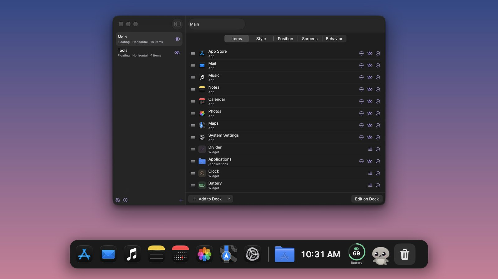
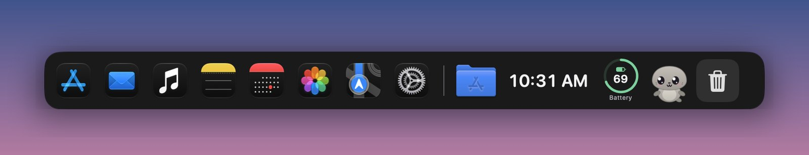
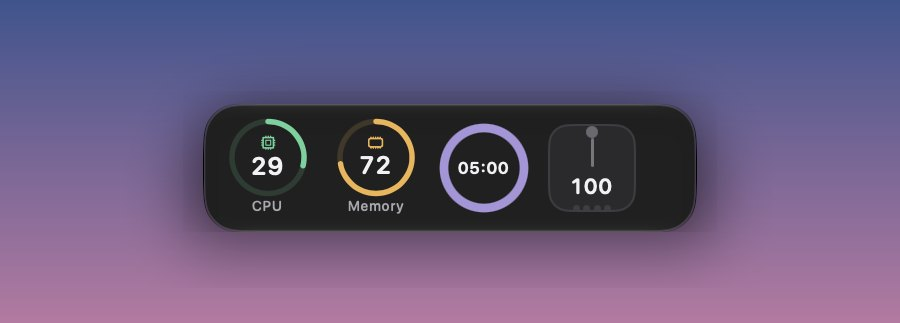
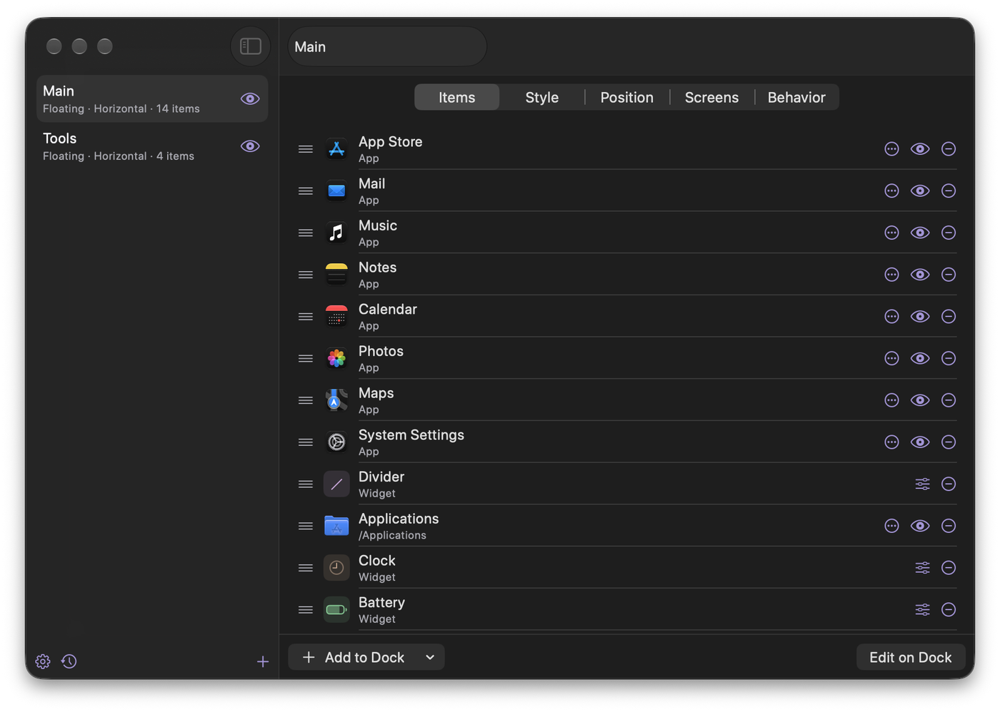
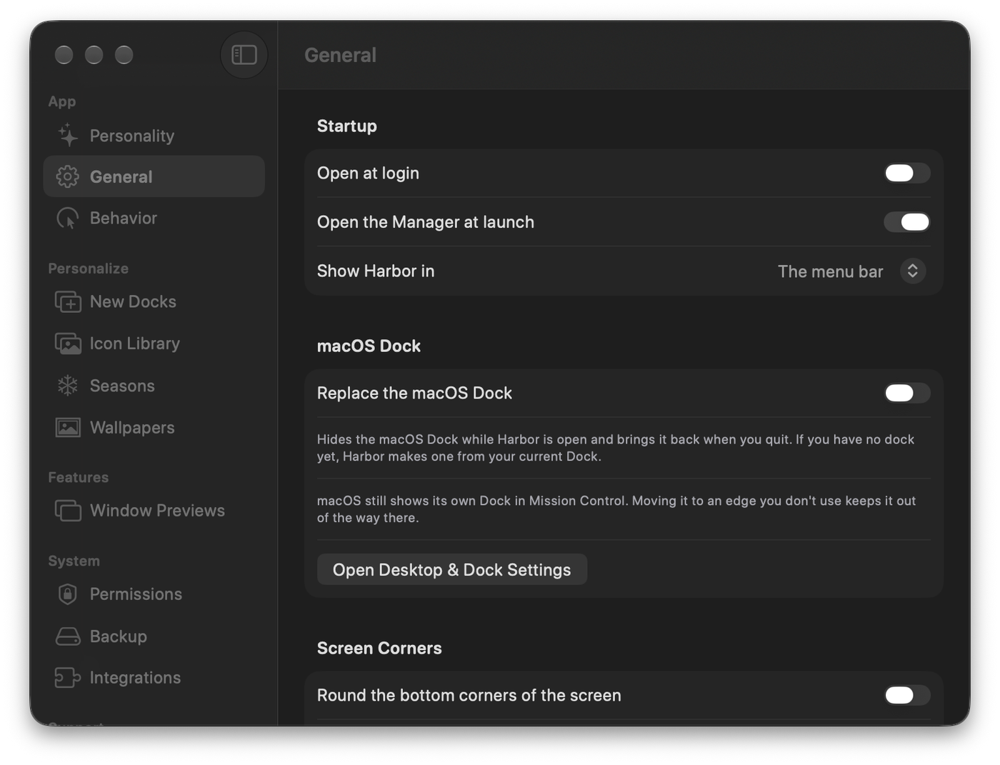
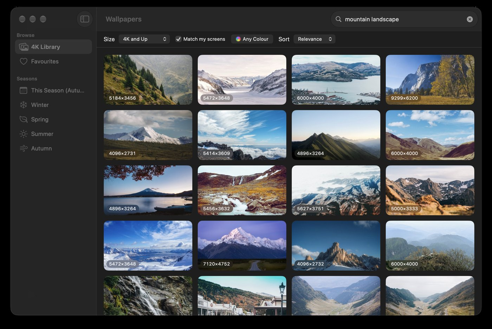
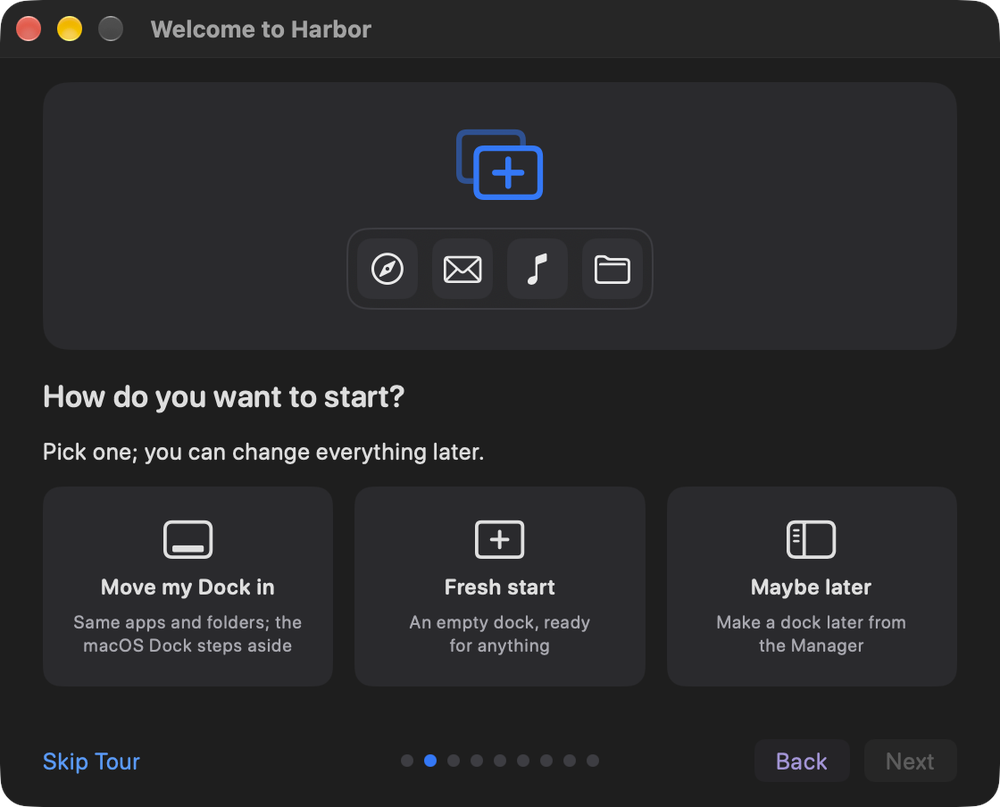
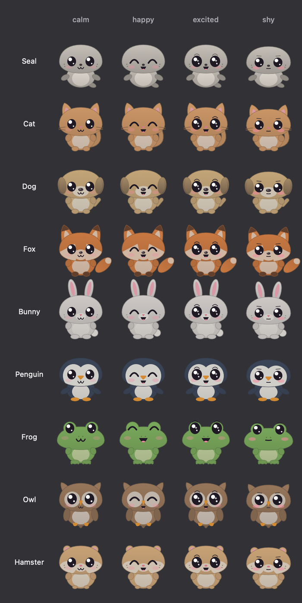

# Harbor

Multiple custom docks for macOS. Put a dock on any edge of any screen, give each one its own look and
behavior, and fill it with apps, folders and widgets.



## Features

- **As many docks as you like.** Pin one to any edge (12 positions), float it anywhere, or fold it into a
  notch-style pill. Docks remember their screen through sleep and unplugging, and can mirror onto every display.
- **Your look.** Glass, blur, solid or no background, borders, corner styles, tinted icons, magnification,
  labels and saved themes. Optional ambient effects such as snow, rays and fireworks.
- **Behaves the way you want.** Auto-hide, hide in fullscreen, fade under windows, keep windows off docks,
  a keyboard shortcut per dock, Keep Dock Shown, window previews, notification badges and click or scroll gestures.
- **Replace the macOS Dock** if you like. Harbor hides it while it runs and gives it back when you quit.
- **24 widgets.** Clock, link, Finder, IP address, spacer, divider, label, folder and app stacks, two shelves,
  Trash, Live Dock, running apps, desktop apps and Space indicator, CPU, memory, GPU, battery, Bluetooth
  battery, counter, timer, metronome and a pet.
- **Folders that open in place.** Click a folder on a dock to browse it in a small Finder window, in List
  or Icons view, and drag files in or out.
- **A dock pet.** Nine species (seal, cat, dog, fox, bunny, penguin, frog, owl, hamster) with colours,
  markings and accessories. Let it roam your desktop and walk along your windows, or pick it up and toss it.
- **Desktop weather and seasons.** Snow, leaves, petals or fireflies that fall and settle on your windows,
  following the season or one you pick. Off until you turn it on.
- **Wallpapers.** Search and set free high-resolution wallpapers, keep favourites, and optionally change them
  with the seasons.
- **Rounded screen corners** for displays that don't have them.
- **Backups.** Daily snapshots, settings export and an icon library.
- **Automation.** `harbor://` URLs for Shortcuts and scripts, and a bundled `harbor-mcp` server so AI
  assistants can change your docks after you approve.
- **A guided tour** on first launch, which you can open again from the menu bar with Show Tour.

## Screenshots

| | |
|---|---|
|  |  |
|  |  |
|  |  |

<p align="center"></p>

## Requirements

- macOS 26 (Tahoe) or later
- An Apple silicon Mac for the release download (Intel Macs can build from source)

## Install

1. Download `Harbor-<version>.zip` from the [Releases](https://github.com/Albertlungu/harbor/releases) page.
   You can check it against the `.sha256` file next to it with `shasum -a 256 Harbor-<version>.zip`.
2. Unzip it and move **Harbor.app** to your **Applications** folder.
3. Harbor isn't notarized by Apple yet, so macOS blocks the first launch. Either right-click Harbor.app,
   choose **Open**, then **Open** again, or run:

   ```bash
   xattr -dr com.apple.quarantine /Applications/Harbor.app
   ```

4. Open Harbor. It lives in the menu bar; the tour helps you make your first dock.

## Permissions

Harbor asks for each permission only when a feature needs it, and works without any of them. You can see
and change them all in Settings > Permissions.

| Permission | Used for | Without it |
|---|---|---|
| Accessibility | Bringing back a specific window, minimizing, stepping through windows, keeping windows off docks, and keeping the hidden macOS Dock from popping up | Clicking an app just switches to it |
| Screen Recording | Window preview thumbnails, and letting a roaming pet see ledges in windows | Previews show window titles instead |
| Automation (Finder, Music, Spotify) | Emptying the Trash from the Trash widget, and media controls in the menu | The Trash opens in Finder instead |
| Bluetooth | Battery levels in the Bluetooth Battery widget | The widget can't show accessory batteries |
| Desktop, Documents, Downloads folders | Showing those folders when you pin or browse them | Those folders can't be browsed |

## Privacy

Harbor has no accounts, analytics or tracking, and your settings never leave your Mac. It only goes online
when you use a feature that needs to:

- **Wallpapers** searches and downloads pictures from the [Wallhaven](https://wallhaven.cc) API.
- **The IP Address widget** asks `api.ipify.org` for your public IP address.
- **Link widgets** and custom icons from a web address download that site's icon or that image.

Settings are stored in `~/Library/Application Support/Harbor`.

## Uninstall

1. If **Replace the macOS Dock** is on, turn it off (menu bar > Hide macOS Dock) or just quit Harbor;
   either brings the macOS Dock back.
2. Quit Harbor and drag Harbor.app to the Trash.
3. Optionally remove its settings and backups:

   ```bash
   rm -rf ~/Library/Application\ Support/Harbor
   defaults delete io.github.albertlungu.harbor
   ```

### If the macOS Dock stays hidden

If Harbor was force quit, crashed or was deleted while it was hiding the macOS Dock, the Dock can stay
hidden. Opening Harbor again and quitting it restores it. Without Harbor, run:

```bash
defaults write com.apple.dock autohide -bool false
defaults delete com.apple.dock autohide-delay
killall Dock
```

(Use `autohide -bool true` instead if you had the Dock set to hide automatically.)

## Troubleshooting

- **A permission shows as on in System Settings but Harbor says it's missing.** This happens after updating
  to a build with a different signature. Open Settings > Permissions and use **Reset and Ask Again**.
- **A dock disappeared.** Open the Manager from the menu bar; the eye button shows or hides each dock, and the
  Screens tab shows which display it is assigned to. Docks assigned to a disconnected display come back when
  it is plugged in again.
- **My settings were reset.** If `config.json` is damaged, Harbor loads the newest good backup and keeps the
  damaged file beside it as `config.damaged-<time>.json`. Backups can be restored from the clock button at the
  bottom of the Manager's sidebar.
- **Harbor uses more energy than expected.** Desktop Weather and dock effects are animated; turn them off from
  the menu bar (Desktop Weather) or a dock's Style tab. Weather pauses in Low Power Mode.
- **Reporting a bug.** Settings > Support can export logs and dock diagnostics (item paths and window titles
  left out) to attach to an [issue](https://github.com/Albertlungu/harbor/issues).

## Building from source

Requires macOS 26 or later and Swift 6.2 (Xcode 26 or the Command Line Tools).

```bash
make test      # unit tests
make app       # builds and signs dist/Harbor.app
make run       # builds and opens it
make install   # replaces /Applications/Harbor.app and relaunches it
make release   # tests, builds, signs and zips dist/Harbor-<version>.zip with a SHA-256 file
```

The version comes from `CFBundleShortVersionString` in `Support/Info.plist`.

Builds are signed ad hoc unless you create a local signing identity once with
`Scripts/make-signing-identity.sh`. A fixed identity keeps macOS privacy grants working across rebuilds.

Set `HARBOR_HOME=/some/folder` to run against a separate config instead of
`~/Library/Application Support/Harbor`.

## Background

Harbor is an independent, open-source app that rebuilds the features of a commercial multi-dock app from its
public documentation. It contains none of that app's code or assets. The research notes and build log are in
`replica/`.
